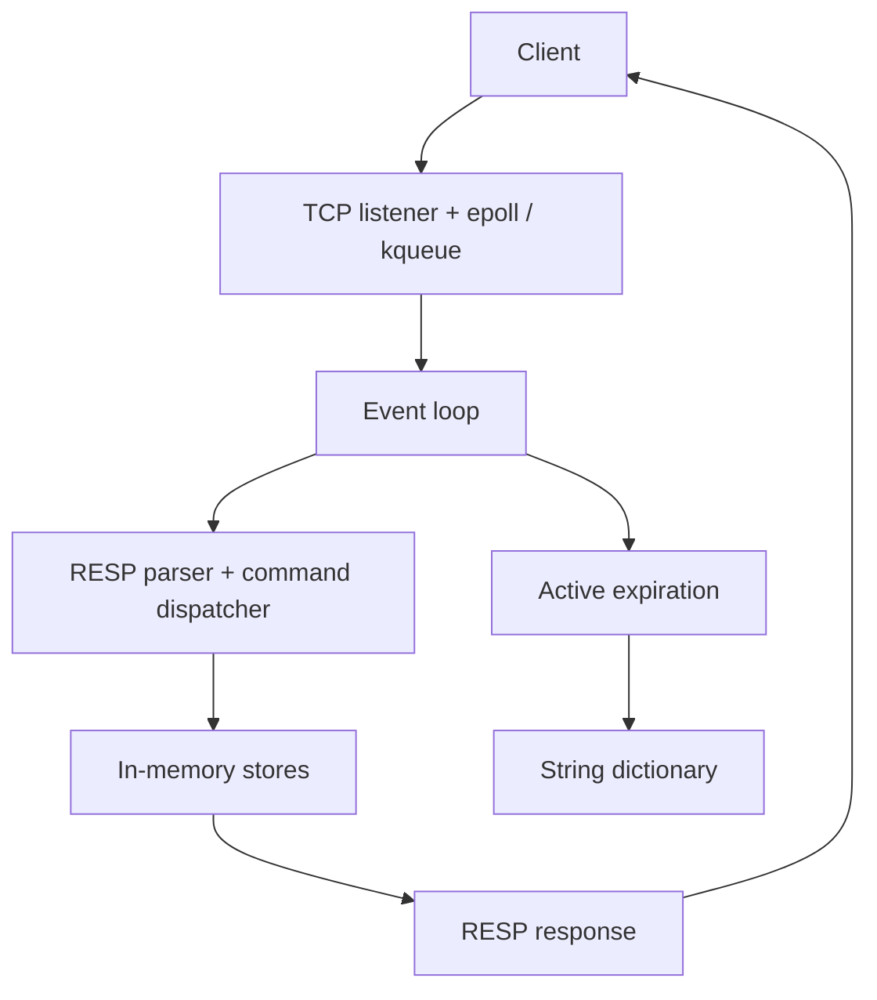

# Redis

I'm building a Redis-style, in-memory server from scratch in Go to understand how Redis works and develop features beyond what standard Redis offers. My goal is to use it in my other personal projects and eventually make it useful to others.

All the code was written by me, up until the time I updated this document.

## What I've built

- I designed a TCP server around a single event loop, using `epoll` on Linux and `kqueue` on macOS.
- I implemented RESP parsing and encoding so I can send commands with `redis-cli`.
- I added string storage with expiration, sets, and sorted sets backed by a custom B+ tree.
- I implemented Bloom filters for approximate membership checks and Count-Min Sketches for frequency estimates.
- I explored random and approximate LRU eviction, along with active expiration.
- I built separate TCP and worker-pool examples to explore connection handling.

## Main server architecture

I designed the server to accept connections and execute commands sequentially in one event loop, with a shared interface for Linux and macOS event notification.



## Supported commands

| Category | Commands |
| --- | --- |
| Basic | `PING`, `SET`, `GET`, `TTL`, `INFO` |
| Sets | `SADD`, `SREM`, `SISMEMBER`, `SMEMBERS` |
| Sorted sets | `ZADD`, `ZSCORE`, `ZRANK` |
| Bloom filters | `BF.RESERVE`, `BF.MADD`, `BF.EXISTS` |
| Count-Min Sketches | `CMS.INITBYDIM`, `CMS.INITBYPROB`, `CMS.INCRBY`, `CMS.QUERY` |

## Run locally

With Go 1.23 or later on Linux or macOS:

```bash
go mod download
go run ./cmd
```

The server listens on port `3000`. In another terminal, with `redis-cli` installed:

```bash
redis-cli -p 3000 PING
redis-cli -p 3000 SET greeting hello
redis-cli -p 3000 GET greeting
redis-cli -p 3000 SET temporary value EX 60
```

I keep the server and eviction settings in [`internal/config/config.go`](internal/config/config.go).

## Testing and benchmarking

### Tests

I added tests for RESP decoding, nested arrays, two-dimensional string-array encoding, and command parsing in [`internal/core/resp_test.go`](internal/core/resp_test.go).

```bash
go test ./...
```

These tests focus on the protocol layer; they do not yet comprehensively cover command behavior, networking, expiration, eviction, or the data structures.

### I/O model benchmark

I compared the main event-loop server with my goroutine-per-connection TCP echo example using `redis-benchmark`. I ran each server separately on port `3000` and repeated this workload ten times per implementation:

```bash
redis-benchmark -n 10000 -t ping_mbulk -c 200 -h localhost -p 3000 --csv
```

Each run sent **10,000 requests** with **200 concurrent clients** using `PING_MBULK`. The recorded averages were:

| Metric | I/O multiplexing | TCP echo example |
| --- | ---: | ---: |
| Throughput (requests/sec) | 88,720.15 | 71,345.63 |
| Average latency (ms) | 1.454 | 1.948 |
| p50 latency (ms) | 1.364 | 1.445 |
| p95 latency (ms) | 2.623 | 3.837 |
| p99 latency (ms) | 3.117 | 4.341 |

In these runs, the event-loop server achieved **24.35% higher throughput** and **25.39% lower average latency**. The percentile values above are averages of each run's reported percentiles, rather than percentiles calculated from a combined distribution.

This comparison reflects these specific implementations and the local workload. The main server parses and executes commands, while the TCP example echoes input, so the results do not isolate the effect of the concurrency model. Each connection in the TCP example uses a Go goroutine, which is not necessarily a dedicated operating-system thread.

The full measurements are in my [I/O benchmark report](docs/io%20models/benchmark.md). For more on the architecture, data structures, and implementation, see [PROJECT_DETAILS.md](docs/PROJECT_DETAILS.md).

## References

I researched and referred to the official Redis documentation and source code while building this project:

- [Official Redis documentation](https://redis.io/docs/latest/)
- [Redis source code](https://github.com/redis/redis)
