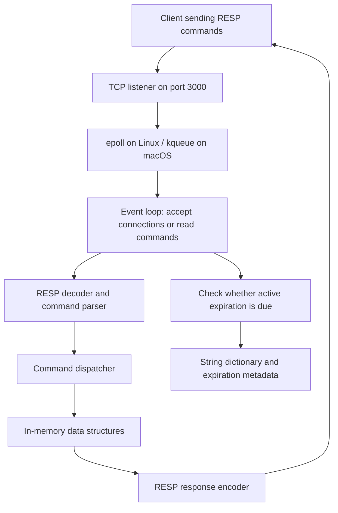

# Project Details: Redis from Scratch

## Overview

This project builds a Redis-style, in-memory server from scratch in Go. It explores TCP networking, I/O multiplexing, the Redis Serialization Protocol (RESP), command execution, expiration, eviction, and data structures used for exact and approximate queries.

The main application is an educational implementation with a subset of Redis commands. It also includes standalone TCP and worker-pool experiments for studying different approaches to handling connections.

This document describes the current source code. Features described as experimental or incomplete should not be assumed to have full Redis compatibility.

## Technology and dependencies

| Component | Implementation |
| --- | --- |
| Language | Go; `go.mod` declares Go 1.23 |
| Module | `ngvanthanggit` |
| Transport | TCP, default port `3000` |
| Wire protocol | A subset of RESP, with commands sent as arrays of bulk strings |
| Linux event notification | `epoll` through `syscall` |
| macOS event notification | `kqueue` through `syscall` |
| Hashing | `github.com/spaolacci/murmur3` for probabilistic structures |
| Test assertions | `github.com/stretchr/testify` |

The main server has platform-specific implementations for Linux and macOS. There is no Windows I/O multiplexer implementation.

## Repository structure

```text
.
├── cmd/
│   └── main.go                  # Main Redis-style server entry point
├── internal/
│   ├── config/config.go         # Network and eviction settings
│   ├── constant/constant.go     # RESP replies and algorithm defaults
│   ├── server/server.go         # Listener, event loop, reads, and dispatch
│   ├── core/
│   │   ├── command.go           # Parsed command representation
│   │   ├── executor.go          # Command dispatch and basic commands
│   │   ├── resp.go              # RESP encoding, decoding, and parsing
│   │   ├── resp_test.go         # Protocol tests
│   │   ├── storage.go           # Initialization of in-memory stores
│   │   ├── expire.go            # Sample-based active expiration
│   │   ├── command_set.go       # Set commands
│   │   ├── command_sorted_set.go
│   │   ├── command_bloom.go
│   │   ├── command_cms.go
│   │   └── io_multiplexing/     # Common event interface, epoll, and kqueue
│   └── data_structure/
│       ├── dict.go              # String values, expiry metadata, eviction
│       ├── eviction_pool.go     # Candidates for approximate LRU eviction
│       ├── stats.go             # Keyspace counters
│       ├── simple_set.go        # Map-backed sets
│       ├── sorted_set.go        # Sorted-set wrapper
│       ├── bplus_tree.go        # B+ tree implementation
│       ├── bloom.go             # Bloom filter
│       └── cms.go               # Count-Min Sketch
├── TcpServer/TcpServer.go       # Standalone goroutine-per-connection echo server
├── ThreadPool/                  # Standalone worker-pool HTTP demonstration
├── docs/io models/              # I/O diagrams and benchmark report
├── go.mod
└── README.md
```

## Main server architecture

[`cmd/main.go`](../cmd/main.go) starts `server.RunIoMultiplexingServer()`.



The server registers the listening socket for readable events. When it becomes ready, the loop accepts a client and registers its socket. For client events, the server reads a command, parses it, executes its handler, and writes a RESP response.

Command names are converted to uppercase before dispatch. The main server processes commands sequentially in its event loop; it does not create a goroutine for every connection. The separate TCP example uses that goroutine-per-connection approach.

The multiplexer abstraction exposes `Monitor`, `Wait`, and `Close`, allowing the server to use the same event-processing code with either operating-system backend.

## Implemented command surface

These commands appear in the dispatcher in [`internal/core/executor.go`](../internal/core/executor.go). Syntax below describes the intended basic invocation; optional Redis features beyond those listed are not implemented.

| Category | Command syntax | Behavior |
| --- | --- | --- |
| Connection | `PING [message]` | Returns `PONG`, or echoes the supplied message |
| Strings | `SET key value [EX seconds]` | Stores a value, optionally with an expiration |
| Strings | `GET key` | Returns a value or a null bulk string |
| Expiration | `TTL key` | Returns remaining seconds or a special negative value; see limitations |
| Information | `INFO` | Returns a basic keyspace information section |
| Sets | `SADD key member [member ...]` | Adds members and returns the number newly added |
| Sets | `SREM key member [member ...]` | Removes members and returns the number removed |
| Sets | `SISMEMBER key member` | Returns `1` or `0` for membership |
| Sets | `SMEMBERS key` | Returns the members; map iteration does not guarantee ordering |
| Sorted sets | `ZADD key score member [score member ...]` | Inserts scored members |
| Sorted sets | `ZSCORE key member` | Returns a member's score, or null when absent |
| Sorted sets | `ZRANK key member` | Looks up a member's rank in the B+ tree |
| Bloom filter | `BF.RESERVE key error_rate capacity` | Creates a filter with explicit parameters |
| Bloom filter | `BF.MADD key item [item ...]` | Adds items; creates a default filter when absent |
| Bloom filter | `BF.EXISTS key item` | Tests probable membership |
| Count-Min Sketch | `CMS.INITBYDIM key width depth` | Creates a sketch with explicit dimensions |
| Count-Min Sketch | `CMS.INITBYPROB key error probability` | Computes dimensions and creates a sketch |
| Count-Min Sketch | `CMS.INCRBY key item increment [item increment ...]` | Increases approximate frequency counters |
| Count-Min Sketch | `CMS.QUERY key item [item ...]` | Returns estimated frequencies |

Unknown commands produce a RESP error. Lists, hashes, transactions, pub/sub, scripting, replication, and disk persistence are not implemented.

## Storage and data structures

### String dictionary

The dictionary maps string keys to objects containing a value and its last-access timestamp. A second map stores expiration deadlines as Unix timestamps in milliseconds.

`SET` replaces the value and sets or clears its expiration metadata. `GET` updates the access timestamp for existing values and returns null for expired entries.

### Sets and sorted sets

Simple sets use maps for membership, insertion, and removal. Sorted sets delegate insertion, score lookup, and rank lookup to a custom B+ tree. The tree compares items by score, then member name, and includes node-splitting logic.

### Bloom filters

The Bloom filter uses a byte-backed bit array and derives multiple hash positions from a seeded MurmurHash3 128-bit hash. It sizes the array and hash count from the requested capacity and error rate.

Membership is probabilistic: a positive result can be a false positive. `BF.MADD` automatically creates a filter with capacity `100` and error rate `0.01` if the key is absent. The implementation uses a fixed bit array; it does not automatically expand as more items are added.

### Count-Min Sketch

The Count-Min Sketch stores a two-dimensional array of unsigned 32-bit counters. Each row uses a different MurmurHash3 seed. Queries return the minimum of the counters selected for an item, so hash collisions can overestimate its frequency.

Counters saturate at the maximum unsigned 32-bit value. The probability-based constructor computes width as `ceil(2 / error)` and depth as `ceil(log10(probability) / log10(0.5))`.

### Separate stores

Strings, sets, sorted sets, Bloom filters, and sketches each have their own top-level map. They do not share Redis's unified, type-aware keyspace. The same key name can therefore exist independently in multiple stores. Expiration and dictionary eviction apply to string storage, not all data types.

## Expiration and eviction

Active expiration samples up to `20` expiration entries per pass and deletes expired keys. It repeats while at least `10%` of the configured sample size was expired. The event loop checks whether this work is due with a target interval of `100 ms`.

This is not an independent timer: the multiplexer waits indefinitely for events, so active expiration can be delayed when the server is idle. On reads, expired values are hidden, but the passive deletion call is currently commented out.

Two experimental eviction policies exist:

- `allkeys-random`: removes entries selected through Go map iteration.
- `allkeys-lru`: samples keys into a bounded candidate pool sorted by last-access time and removes older candidates.

Eviction currently runs during `GET` only when the dictionary size equals `MaxKeyNumber`. It is not enforced during insertion and is not a reliable maximum-memory or maximum-key limit.

## Configuration

Settings are source-level variables in [`internal/config/config.go`](../internal/config/config.go); the application does not expose configuration flags or environment-variable parsing.

| Setting | Default | Purpose |
| --- | --- | --- |
| `Protocol` | `tcp` | Listener transport |
| `Port` | `:3000` | Listen address; no specific host is selected |
| `MaxConnection` | `20000` | Multiplexer event-buffer size; not an enforced connection cap |
| `MaxKeyNumber` | `10` | Dictionary eviction threshold |
| `EvictionRatio` | `0.1` | Fraction of the threshold used to calculate an eviction batch |
| `EvictionPolicy` | `allkeys-random` | Dictionary eviction strategy |
| `EpoolMaxSize` | `10` | Maximum LRU candidate-pool length |
| `EpoolLruSampleSize` | `5` | Keys sampled when populating the LRU pool |

[`internal/constant/constant.go`](../internal/constant/constant.go) also defines expiration defaults, B+ tree degree (`4`), default Bloom-filter parameters, and common RESP replies.

## Running the project

Use Go 1.23 or later on Linux or macOS. Run these commands from the repository root:

```bash
go mod download
go run ./cmd
```

To build an executable:

```bash
go build -o redis-server ./cmd
./redis-server
```

With a separately installed `redis-cli`, issue individual commands against port `3000`:

```bash
redis-cli -h 127.0.0.1 -p 3000 PING
redis-cli -h 127.0.0.1 -p 3000 SET greeting hello
redis-cli -h 127.0.0.1 -p 3000 GET greeting
redis-cli -h 127.0.0.1 -p 3000 SET temporary value EX 60
redis-cli -h 127.0.0.1 -p 3000 TTL temporary
redis-cli -h 127.0.0.1 -p 3000 SADD colors red blue
redis-cli -h 127.0.0.1 -p 3000 SMEMBERS colors
redis-cli -h 127.0.0.1 -p 3000 ZADD leaderboard 10 alice 20 bob
redis-cli -h 127.0.0.1 -p 3000 ZSCORE leaderboard alice
redis-cli -h 127.0.0.1 -p 3000 BF.RESERVE seen 0.01 1000
redis-cli -h 127.0.0.1 -p 3000 BF.MADD seen apple banana
redis-cli -h 127.0.0.1 -p 3000 BF.EXISTS seen apple
redis-cli -h 127.0.0.1 -p 3000 CMS.INITBYDIM counts 100 5
redis-cli -h 127.0.0.1 -p 3000 CMS.INCRBY counts apple 3
redis-cli -h 127.0.0.1 -p 3000 CMS.QUERY counts apple
```

Client libraries that automatically send commands such as `HELLO`, `AUTH`, or `SELECT` may require configuration or encounter unsupported-command errors.

The standalone experiments can be run separately:

```bash
go run ./TcpServer
go run ./ThreadPool
```

Each experiment also uses port `3000`, so run only one server at a time. `TcpServer` echoes received bytes. `ThreadPool` runs two goroutine workers consuming connections from an unbuffered channel, waits five seconds per request, and returns a basic HTTP greeting. These examples do not execute the main server's Redis commands.

## Tests and existing benchmarks

Run the existing tests with:

```bash
go test ./...
```

The current test file, [`internal/core/resp_test.go`](../internal/core/resp_test.go), covers RESP decoding, nested arrays, two-dimensional string-array encoding, and command parsing. It does not provide comprehensive coverage of command semantics, networking, expiration, eviction, or data structures.

The existing [I/O benchmark report](io%20models/benchmark.md) records ten runs per implementation, each using `10,000` requests and `200` concurrent clients with the `PING_MBULK` workload:

```bash
redis-benchmark -n 10000 -t ping_mbulk -c 200 -h localhost -p 3000 --csv
```

| Reported average | I/O multiplexing | TCP echo example |
| --- | ---: | ---: |
| Requests per second | 88,720.15 | 71,345.63 |
| Average latency | 1.454 ms | 1.948 ms |

These are historical results copied from the repository report, not measurements made for this document. The implementations perform different application work: the main server parses and executes commands, while the TCP example echoes input. The results do not isolate the concurrency model's contribution or establish full Redis performance or compatibility. Go goroutines in the comparison are not dedicated operating-system threads.

## Current limitations

- **Volatile storage:** all data is lost when the process exits; there is no RDB or AOF persistence.
- **Basic network framing:** each readable event triggers one 512-byte read and one command parse. There is no buffering for fragmented commands or processing loop for pipelined commands. Partial writes are not retried.
- **Limited malformed-input handling:** the parser assumes an array of strings and uses unchecked indexing and type assertions in several places. Invalid input can panic, and several server errors call `log.Fatal`, terminating the process.
- **Partial command compatibility:** `SET` accepts a four-argument expiration form without validating the `EX` token. `TTL` returns `-1` for a missing key with no expiry metadata rather than Redis's `-2`. Argument validation and sorted-set update behavior need further compatibility testing.
- **Incomplete statistics:** `INFO` uses a counter that increments on missing dictionary reads rather than successful insertion, and reports fixed values for expiration count and average TTL. It is not a reliable inventory of stored keys.
- **Experimental capacity management:** eviction happens on reads at an exact dictionary size; it does not impose a dependable resource bound. Expiration and eviction do not cover the other stores.
- **Limited parameter validation:** Bloom-filter and sketch constructors lack complete checks for invalid capacities, dimensions, and probability ranges.
- **Minimal operational features:** there is no authentication, TLS, graceful shutdown workflow, replication, clustering, or comprehensive observability.

## Possible next steps

1. Buffer TCP input per connection and parse complete RESP frames, including multiple commands per read.
2. Add bounds checks and return protocol errors without terminating the server.
3. Introduce a unified typed keyspace with consistent expiration and wrong-type handling.
4. Correct `TTL`, keyspace counters, eviction triggers, and command argument validation.
5. Add behavioral tests for commands and data structures, plus network integration tests.
6. Compare networking models using identical command-handling work and documented hardware and runtime settings.
7. Add configurable listen settings, graceful shutdown, and persistence as the implementation matures.
